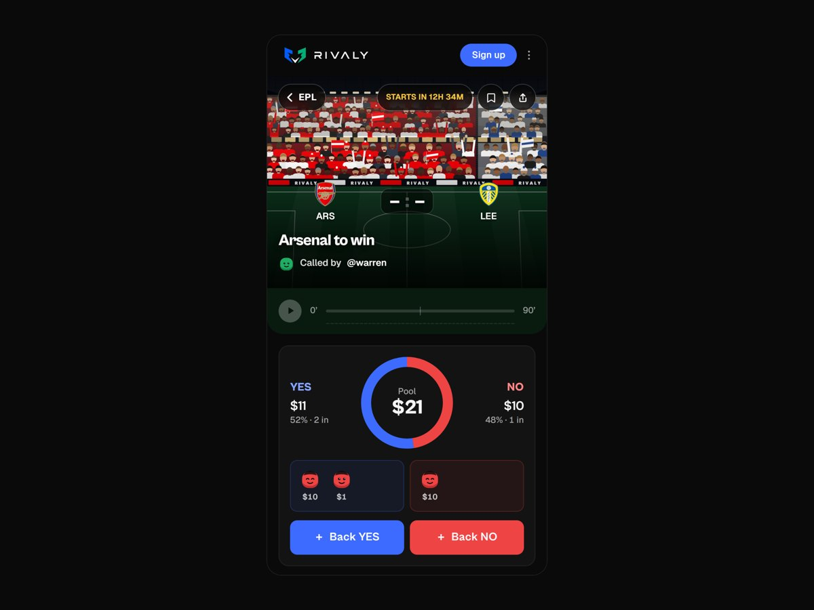
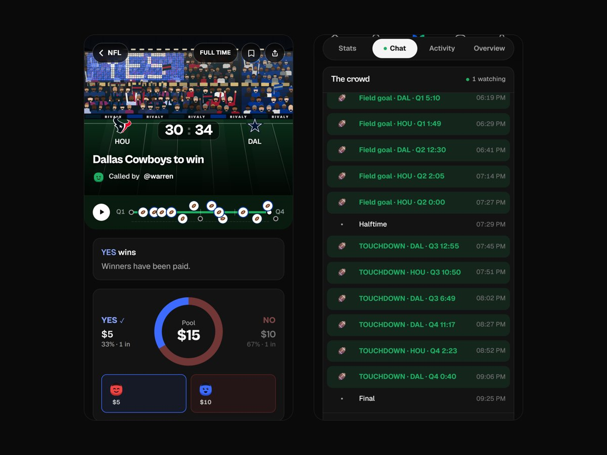
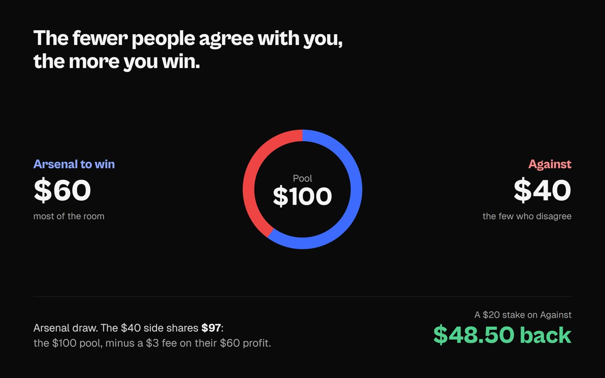
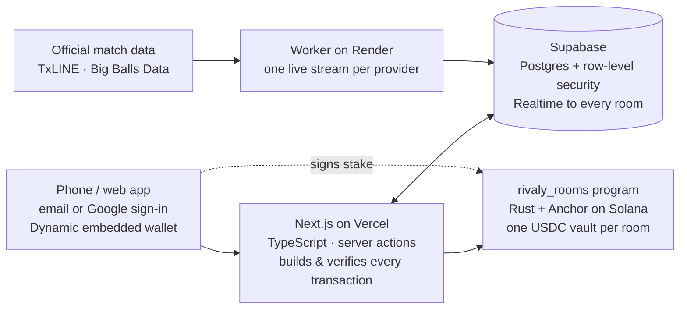
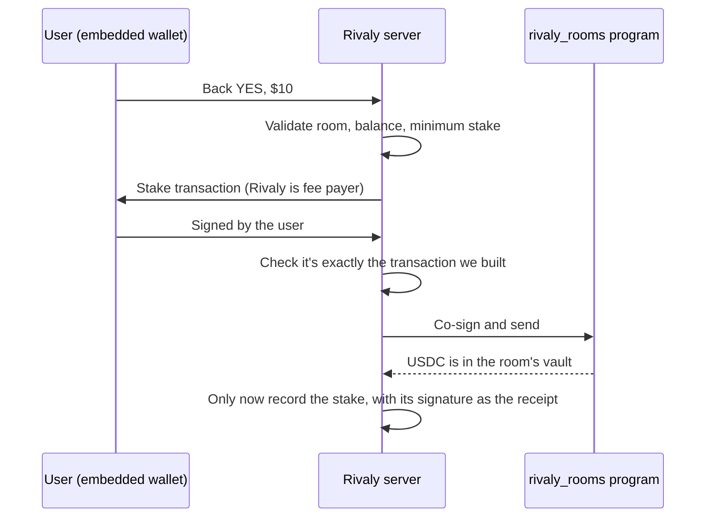
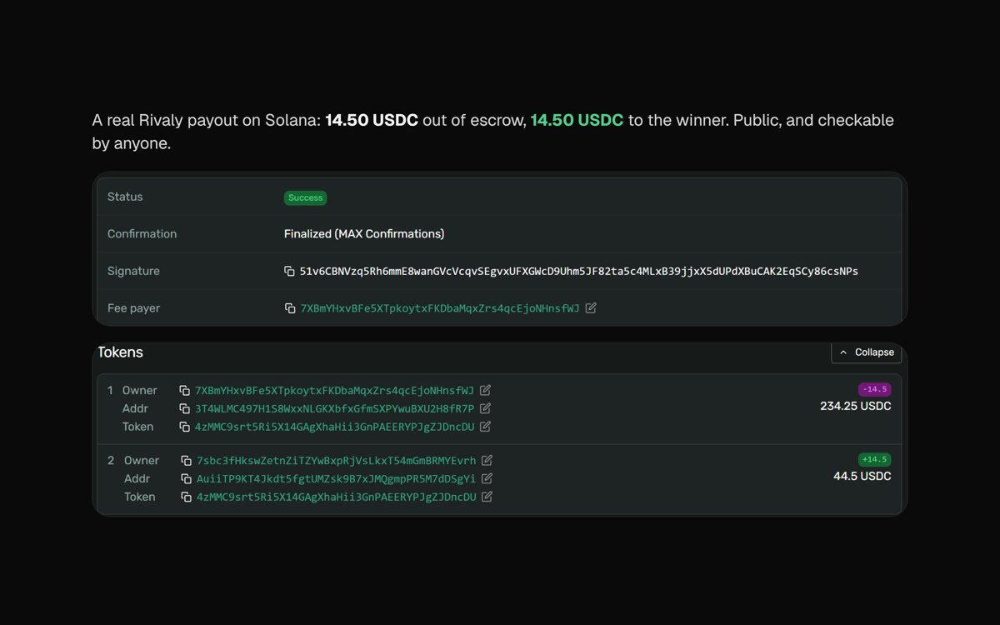

<div align="center">


# Rivaly

**Social prediction for sport, on Solana.**
Make a call on a match, someone takes the other side, you watch it together, and the winners split the pool, paid on-chain in seconds. People play people, never the house.

[**Live app**](https://www.rivaly.fun) · [How it works](https://www.rivaly.fun/docs) · [Program on Solana Explorer](https://explorer.solana.com/address/FwPoC3NgmMVwoHk7QUGGotmx7dbsSNF5E6N7enxx7kLF?cluster=devnet) · [X / @Rivaly_fun](https://x.com/Rivaly_fun)


</div>

---

## The problem

Predicting sport has always been social. Every weekend, group chats call the match, argue about it, and say "bet you". 38% of US sports bettors already bet with friends ([Conjointly, 2025](https://conjointly.com/blog/sports-betting-us-2025/)).

But the products built for it make you do it alone:
- **Sportsbooks** make money when you lose.
- **Prediction markets** hand you an order book.
- **The group-chat bet** never gets paid ("I'll send it Friday").

## What Rivaly does

| | |
|---|---|
| **1 · Make a call** | Pick a match and a prediction: "Arsenal to win", "Over 2.5 goals". It takes four taps and becomes a room with a pool. |
| **2 · Someone takes the other side** | Share the link in the group chat. Anyone can back YES or NO, with $1 minimum stakes in USDC. |
| **3 · Watch it together** | The room has live scores, a match timeline, line-ups, stats and a chat for everyone with a stake. All of it is fed by official match data. |
| **4 · Winners split the pool** | When the result is certain, the room settles itself. Winners share the pool pro rata, paid on Solana in seconds. A void or one-sided room refunds everyone. |

<div align="center">


</div>

**Rivaly is the referee, never a player.** It never takes a side. When fees are on, they're 5% of the winners' *profit*, never of a stake: 3% to Rivaly and 2% to the room's host, so the people who bring their crowd earn when that crowd plays. Losers never pay a fee.

<div align="center">

</div>

## Traction (beta, Solana devnet)

- **77** unique users. In a single game week: **300+ predictions** across **73 rooms**.
- **96%** of rooms attracted someone on the opposite side.
- **74%** of users created a room themselves.
- **82%** of surveyed users say predicting in a room beats predicting alone.
- Every room has settled **automatically** from official match data, across football (Premier League, Champions League, La Liga, Bundesliga, Serie A, Ligue 1, MLS) and the NFL.

## Architecture



| Layer | Stack |
|---|---|
| App & backend | Next.js 16 (App Router, React 19, TypeScript), Tailwind v4, on Vercel |
| Data & live updates | Supabase: Postgres with row-level security on every table, Realtime, Storage |
| Identity & wallets | Dynamic: email / Google sign-in with an embedded Solana wallet. No seed phrase, no SOL needed |
| Money | USDC on Solana, held by the `rivaly_rooms` program (Rust, Anchor). Rivaly pays all network fees |
| Live sport | An always-on TypeScript worker on Render streaming TxLINE and Big Balls Data |

### How a stake works



Before Rivaly co-signs, it refuses anything that isn't exactly what it built ([`verify-stake-tx.ts`](src/lib/escrow/verify-stake-tx.ts), unit-tested). That means:
- the same fee payer and blockhash;
- exactly two signers;
- an unchanged amount, source, destination and memo;
- wallet-added instructions only from a short allowlist, with the fee capped so one stake can't cost more than 0.0004 SOL.

### How a room settles

- The worker writes every match event as it happens.
- [`resolve.ts`](src/lib/settlement/resolve.ts) decides each market from the official result.
- Two safeguards protect against paying out on a wrong result:
  - a market decided **before** full time is held for a **10-minute safety window** (VAR);
  - if **two data records disagree**, nothing pays until it's resolved.
- The payout plan is computed once, in [`planSettlement`](src/lib/settlement), and the on-chain program uses the same arithmetic. A **400-room parity test** proves the two always agree.

<div align="center">

</div>

## The on-chain program

[`rivaly_rooms`](onchain/programs/rivaly_rooms/src/lib.rs) is live on devnet at [`FwPoC3NgmMVwoHk7QUGGotmx7dbsSNF5E6N7enxx7kLF`](https://explorer.solana.com/address/FwPoC3NgmMVwoHk7QUGGotmx7dbsSNF5E6N7enxx7kLF?cluster=devnet).

**What it guarantees, whatever the server does:**
- A room's USDC can only leave its vault to **the people who staked in that room** (winnings or refunds), plus the room's fee to the treasury once everyone is paid.
- Fees come only from winners' profit, and the program caps them at **6% in total**.
- Stakes close at kick-off. If a room is never resolved, **anyone** can void it after its deadline (14 days after kick-off; the program allows at most 21), and everyone is refunded.
- A stake can only be refunded **before kick-off**. Once the match is under way it plays, so no position can leave after seeing how the match is going.
- Fees can be collected as soon as the result is in, without waiting for every payout, so one payout that can't land (a frozen account) never holds the fees. What's still owed to unpaid winners stays in the vault.
- The admin key moves only in two steps (propose, then accept), ready to hand to a multisig.

**Who holds which key:**

| Key | Can | Can't |
|---|---|---|
| Operator (Rivaly server) | Post results from official data, trigger payouts and refunds, pay fees | Send stakes anywhere but that room's stakers; exceed the fee cap |
| Admin / upgrade authority | Change settings, upgrade the program | Nothing is limited here yet. It moves to a Squads multisig before mainnet. |
| Users | Stake into a vault; void an expired room | Move another person's stake |

**What it doesn't do yet:** decide results. Rivaly's operator posts them from official match data. The program hasn't been audited; that happens before mainnet.

## Quality

- **175+ app tests:** settlement, fees, markets, stake verification, match feed and minute handling.
- **45 program tests:** refusals and attacks, the 400-room parity check, and full start-to-finish runs. [`devnet-e2e.mts`](onchain/scripts/devnet-e2e.mts) also runs the app's own transaction code against the deployed program.
- **Row-level security on every table.** Stakes and entries can only be written by the server after on-chain verification.
- **Two security reviews**, with fixes shipped: [docs/security](docs/security/).

## Repository

```
src/app/          pages and server actions: rooms, arena, wallet, profile, admin
src/components/   UI (src/components/ui/ is the design-system kit)
src/lib/          settlement, markets, fees, escrow + program client, data providers
supabase/         migrations: schema, RLS policies, triggers, SQL functions
worker/           the live-scores worker (TxLINE + Big Balls Data)
onchain/          the rivaly_rooms Anchor program, its tests and deploy scripts
docs/             security reviews and README assets
```

## Roadmap

- **Mainnet:** an audit of `rivaly_rooms`, then the admin key moves to a Squads multisig.
- **Results:** move from operator-posted to a decentralised oracle.
- **Local payments:** cards and mobile money in, USDC underneath, invisible to fans.
- **As liquidity grows:** in-play windows and peer-to-peer cash-out (sell your side to another fan, never to the house).

## Security

Secrets (the database service key, escrow and welcome-wallet keys, API tokens) live only in the hosting providers' environment settings and are never committed. To report a vulnerability, email **support@rivaly.fun** rather than opening a public issue.

## Licence

- **The on-chain program** ([`onchain/`](onchain/)) is **MIT** ([onchain/LICENSE](onchain/LICENSE)), so anyone can read, verify, reuse and build on the contract that holds the money.
- **The app** (everything else) is **AGPL-3.0** ([LICENSE](LICENSE)): open source, and anyone who runs a modified copy as a service must publish their changes too.

"Rivaly" and the Rivaly logo are not covered by these licences.
